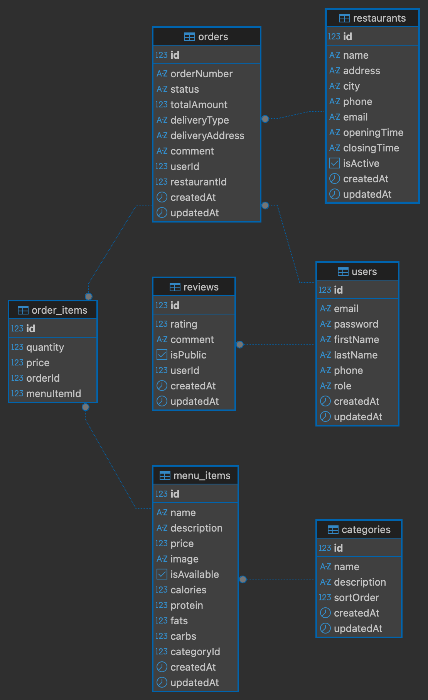

# Los Pollos Hermanos - Backend

Backend приложение для сайта ресторана Los Pollos Hermanos, разработанное на NestJS с использованием шаблонизатора Handlebars.

## Автор

**Polyakov** <svitov20@mail.ru>

## Переключение состояния сессии

Для демонстрации двух состояний сессии (авторизован/не авторизован) используйте query параметр `auth`:

- Неавторизованный пользователь: `http://localhost:3000/`
- Авторизованный пользователь: `http://localhost:3000/?auth=true`

## Деплой

Приложение развернуто на Render: **(https://m3301-polyakov-backend.onrender.com/)**

### Настройки для Render

- **Build Command**: `npm install; npm run build`
- **Start Command**: `npm run start:prod`
- **Environment**: Node
- **Node Version**: 24.x
